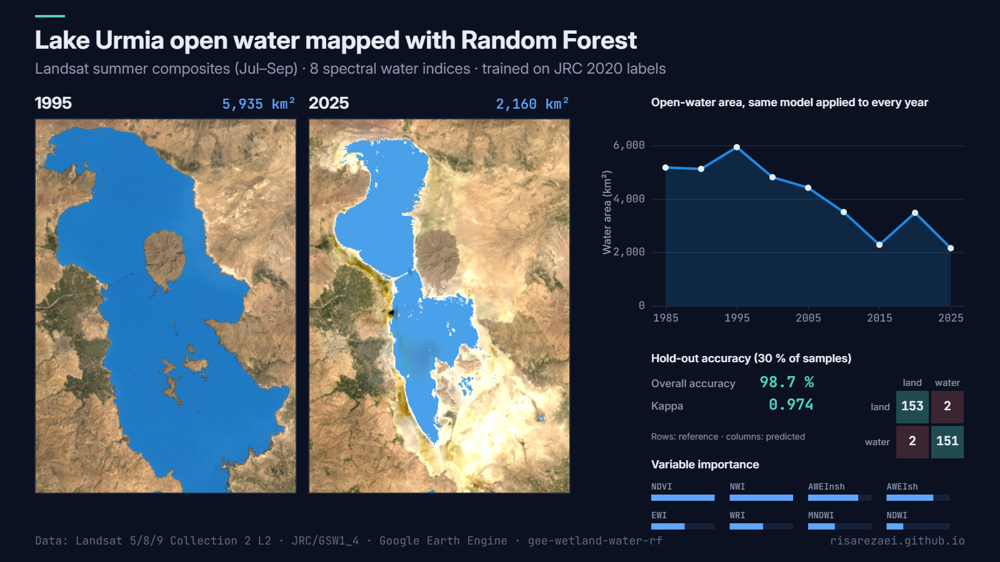

# Wetland Water Mapping with Random Forest

Map **open water in lakes and wetlands** from Landsat with a **Random Forest** classifier trained on eight spectral water indices. The script assesses the map with a **stratified random sample** and reports **area-adjusted accuracy and area with 95 % confidence intervals**, then applies the same model to other years to build a **water-area time series** back to 1984, with the observed area and cloud percentage of every year so that clouds are not mistaken for water loss.

Example output for Lake Urmia with the default settings: classified open water in summer 1995 and 2025, the area series, and the hold-out accuracy.

## What the script does

1. Builds a cloud-masked **seasonal median composite** from Landsat 5, 7, 8 and 9 Collection 2 surface reflectance.
2. Computes eight water and vegetation indices: NDVI, NDWI, MNDWI, AWEInsh, AWEIsh, WRI, NWI and EWI.
3. Gets **training samples** in one of two ways:
   - `'auto'`: stratified samples from the [JRC Global Surface Water](https://global-surface-water.appspot.com/) yearly history of a reference year (permanent water vs. not water). It runs anywhere with no drawing.
   - `'drawn'`: your own points or polygons, drawn as two layers named `water` and `land`.
4. Splits the samples by **spatial blocks** and runs a **hold-out check** (confusion matrix, overall, producer's and user's accuracy, kappa).
5. Charts **variable importance** for the eight indices.
6. Assesses the **map** with a separate stratified random sample and reports area-weighted accuracy, an **area estimate per class**, and **quantity and allocation disagreement** (see below).
7. Classifies the target year and, optionally, a list of years. Each year reports the **water area**, the **observed area**, the **observed share of the ROI** and the **cloud percentage** of the season; years below a coverage threshold are flagged.

## Quick start

1. Open the [Earth Engine Code Editor](https://code.earthengine.google.com).
2. Paste [`wetland_water_rf.js`](wetland_water_rf.js) into a new script.
3. Set `roi` and `year` in `CONFIG` (the default is Lake Urmia, 2025).
4. Press **Run**. The two accuracy blocks, importance and the area series appear in the Console; the water map is added to the Map.
5. Start the GeoTIFF and CSV exports from the **Tasks** tab.

## How accuracy is assessed

The script reports two things, and they answer different questions.

**1. Hold-out check (describes the model).** The training samples are split into training and hold-out sets by square blocks (`blockSize`, 2 km by default): every sample takes the random number of the block it falls in, so neighbouring samples, which look alike, stay on the same side. In `'auto'` mode the samples come only from pixels that JRC calls permanent water or never water, so they leave out the hard cases at the shoreline. This check tells you whether the model learned the classes. It does not estimate the accuracy of the map.

**2. Map accuracy and area (describes the map).** Following Olofsson et al. (2014):

- **Sampling design:** a stratified random sample of the map of `assessment.year`, with mapped land and mapped water as strata (250 points each by default). This is a probability sample of the whole map, so its estimates are design-unbiased and need no correction for spatial autocorrelation (Wadoux et al., 2021).
- **Response design:** each point is labelled from the JRC Global Surface Water **monthly** history of the same months as the composite. A pixel is water if JRC saw water in at least half of the months in which it observed it. Pixels that JRC never observed in those months are left out of the sampling frame, and the share of the ROI that remains is reported (`frame_share_of_roi`).
- **Analysis:** the counts are turned into an area-weighted error matrix with the mapped area of each stratum. The script reports overall, user's and producer's accuracy and an **area estimate per class**, each with a **95 % confidence interval**, and splits the total disagreement (1 − overall accuracy) into **quantity disagreement** and **allocation disagreement** (Pontius & Millones, 2011). Kappa is kept only in the hold-out check, for comparison.

With JRC as the reference, the numbers measure **agreement with JRC Global Surface Water**, which is itself a Landsat product. For a stricter assessment, label the points yourself:

1. Run the script and export `wetland_water_rf_assessment_points_<year>.csv` (columns `lon`, `lat`, `map`, `reference`).
2. Check or correct the `reference` column (0 = land, 1 = water) by visual interpretation, for example on high-resolution imagery of the same season.
3. Upload the CSV as a table asset and set `assessment.referencePoints` to its asset ID. Keep the other settings unchanged so the map is the same.

This also works for years after 2021, which JRC does not cover.

## Results with the default settings

| | Lake Urmia (2020 map) | Loktak Lake (2020 map) |
|---|---|---|
| Hold-out overall accuracy (2 km blocks) | 0.993 | 0.967 |
| Map overall accuracy | 0.978 ± 0.013 | 0.941 ± 0.017 |
| Water: user's / producer's accuracy | 0.960 ± 0.024 / 0.952 ± 0.045 | 0.744 ± 0.054 / 0.881 ± 0.091 |
| Water: mapped / area-adjusted (km²) | 3,302.5 / 3,331.5 ± 176.3 | 71.4 / 60.3 ± 7.3 |
| Quantity / allocation disagreement | 0.002 / 0.020 | 0.026 / 0.033 |
| Share of the ROI in the sampling frame | 0.99 | 0.82 |
| Cloud and cloud-shadow share of all observations, 2025 | 3.9 % | 83.3 % |
| Series years flagged for coverage (of 9) | 0 | 7 |

The hold-out check is higher than the map accuracy in both cases, which is expected. Loktak Lake is partly covered by floating vegetation (phumdis), and the map overestimates open water there. In the July–September monsoon, 67–89 % of the observations are cloud or cloud shadow. 1985 and 1995 have no Landsat scene in the season at all, 1990 has only scenes above the 60 % cloud limit, and 2000–2020 are 50–82 % observed, so only 2005 and 2025 pass the 95 % coverage check. Without the coverage columns, those years would look like years with little or no water.

To run the second example, set `roi: EXAMPLES.loktak`.

## Configuration

| Parameter | Default | Description |
|---|---|---|
| `roi` | `EXAMPLES.urmia` | Area to classify: `EXAMPLES.urmia`, `EXAMPLES.loktak`, a drawn geometry or an asset |
| `year` | `2025` | Year to map |
| `season` | `['07-01', '09-30']` | Month-day window of the composite (within one calendar year) |
| `maxSceneCloud` | `60` | Scenes above this cloud cover (%) are skipped |
| `useLandsat7` | `true` | Include Landsat 7 (gaps after 2003 are filled by the median where other sensors exist) |
| `trainingSource` | `'auto'` | `'auto'` (JRC labels) or `'drawn'` (your `water` / `land` layers) |
| `trainYear` | `2020` | Reference year for `'auto'` labels (1984–2021) |
| `samplesPerClass` | `500` | Training points per class for `'auto'` |
| `features` | 8 indices | Inputs to the classifier |
| `nTrees` | `100` | Number of trees |
| `trainFraction` | `0.7` | Share of blocks used for training; the rest is the hold-out |
| `blockSize` | `2000` | Block edge (m) for the training / hold-out split; `0` splits point by point |
| `assessment.year` | `2020` | Map to assess (1984–2021 with the JRC reference) |
| `assessment.pointsPerClass` | `[250, 250]` | Points in mapped land and mapped water |
| `assessment.referencePoints` | `null` | Asset ID of your own labelled points (optional) |
| `seriesYears` | 1985–2025 every 5 years | Years for the area series (`[]` to skip) |
| `areaScale` | `60` | Scale (m) for the area sums of the series |
| `minObservedFraction` | `0.95` | Years with less of the ROI observed are flagged and left out of the chart |

## Outputs

- `wetland_water_rf_<year>.tif`: water map (1 = water, 0 = not water) at 30 m.
- `wetland_water_rf_map_accuracy.csv`: per class (`land`, `water`): mapped and area-adjusted km² with 95 % CI, user's and producer's accuracy with 95 % CI, number of points; one `overall` row with overall accuracy and CI, quantity and allocation disagreement, sampling-frame area and share of the ROI.
- `wetland_water_rf_assessment_points_<year>.csv`: `lon`, `lat`, `map`, `reference` for every assessment point.
- `wetland_water_rf_holdout.csv`: hold-out overall accuracy, kappa, per-class accuracies, sample counts, block size and the importance of each index.
- `wetland_water_rf_area_series.csv`: `year`, `water_km2`, `observed_km2`, `observed_frac`, `cloud_pct`, `low_coverage` (1 = below `minObservedFraction`), `n_scenes`.

## Notes

- The model is trained once and applied to every year, so all years are classified the same way. The map accuracy is estimated for `assessment.year` only; other years use the same model and processing, but their accuracy is not measured.
- `observed_km2` is the part of the ROI with at least one clear observation in the composite. A flagged year's `water_km2` covers only the observed part, so it is not comparable with the other years.
- `cloud_pct` is the share of all observations of the ROI in the season that Landsat's QA band marks as cloud, dilated cloud or cloud shadow. It counts every scene of the season, also those skipped by `maxSceneCloud`, so it shows how cloudy the season was. It is empty when the season has no scene at all. `n_scenes` counts only the scenes used in the composite.
- With `'auto'`, labels come from JRC permanent water and never-water pixels of `trainYear`. That makes a good general model, but your own samples are better for turbid, saline or vegetated water. Landsat does not see water under vegetation.
- Large regions: raise `areaScale` or `tileScale` if you hit memory limits. The assessment sums run at 30 m.

## Data

- Landsat Collection 2 Level-2: [`LANDSAT/LT05/C02/T1_L2`](https://developers.google.com/earth-engine/datasets/catalog/LANDSAT_LT05_C02_T1_L2), [`LE07`](https://developers.google.com/earth-engine/datasets/catalog/LANDSAT_LE07_C02_T1_L2), [`LC08`](https://developers.google.com/earth-engine/datasets/catalog/LANDSAT_LC08_C02_T1_L2), [`LC09`](https://developers.google.com/earth-engine/datasets/catalog/LANDSAT_LC09_C02_T1_L2)
- JRC Global Surface Water yearly and monthly history: [`JRC/GSW1_4/YearlyHistory`](https://developers.google.com/earth-engine/datasets/catalog/JRC_GSW1_4_YearlyHistory), [`JRC/GSW1_4/MonthlyHistory`](https://developers.google.com/earth-engine/datasets/catalog/JRC_GSW1_4_MonthlyHistory) (Pekel et al., 2016)

## References

- Olofsson, P., Foody, G. M., Herold, M., Stehman, S. V., Woodcock, C. E., & Wulder, M. A. (2014). Good practices for estimating area and assessing accuracy of land change. *Remote Sensing of Environment*, 148, 42–57. https://doi.org/10.1016/j.rse.2014.02.015
- Pekel, J.-F., Cottam, A., Gorelick, N., & Belward, A. S. (2016). High-resolution mapping of global surface water and its long-term changes. *Nature*, 540, 418–422. https://doi.org/10.1038/nature20584
- Pontius, R. G., & Millones, M. (2011). Death to Kappa: birth of quantity disagreement and allocation disagreement for accuracy assessment. *International Journal of Remote Sensing*, 32(15), 4407–4429. https://doi.org/10.1080/01431161.2011.552923
- Wadoux, A. M. J.-C., Heuvelink, G. B. M., de Bruin, S., & Brus, D. J. (2021). Spatial cross-validation is not the right way to evaluate map accuracy. *Ecological Modelling*, 457, 109692. https://doi.org/10.1016/j.ecolmodel.2021.109692

## Changelog

- **1.1.0** (2026-11-18): area-adjusted map accuracy and area estimates with 95 % CIs (Olofsson et al., 2014); quantity and allocation disagreement (Pontius & Millones, 2011); spatially blocked hold-out; observed area, observed share, cloud percentage and a low-coverage flag in the area series; a second, small and cloudy example (Loktak Lake); assessment points exported for relabelling.
- **1.0.0** (2026-10-25): first release.

## Cite this tool

Abbasalizadehrezaei, P. (2026). *Wetland Water Mapping with Random Forest* (Version 1.1.0) [Software]. Zenodo. https://doi.org/10.5281/zenodo.23646350

GitHub also offers a ready-made citation under **Cite this repository** (from [CITATION.cff](CITATION.cff)).

## Author

**Parisa Abbasalizadehrezaei** · [risarezaei.github.io](https://risarezaei.github.io)

Released under the [MIT License](LICENSE).
