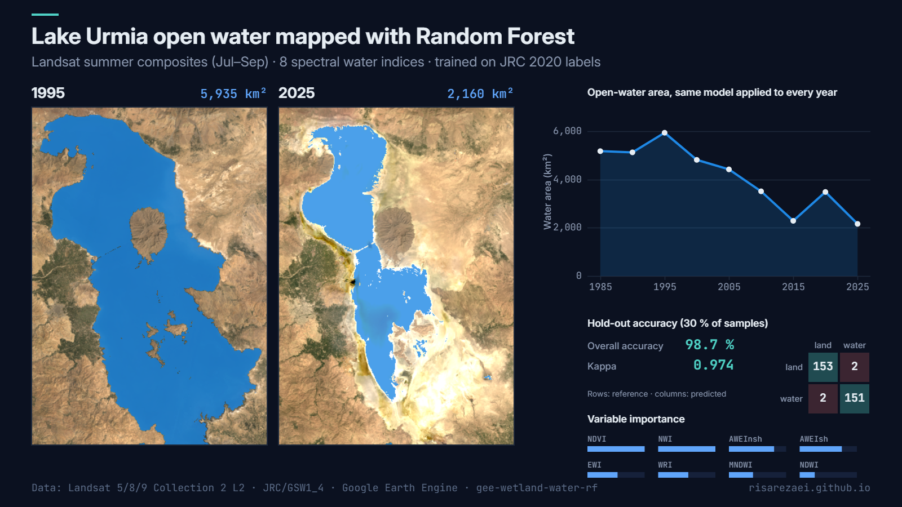

# Wetland Water Mapping with Random Forest

Map **open water in lakes and wetlands** from Landsat with a **Random Forest** classifier trained on eight spectral water indices. The script checks its own accuracy on held-out samples, shows which indices mattered, and can apply the same model to other years to build a **water-area time series** back to 1984.

Example output for Lake Urmia with the default settings: classified open water in summer 1995 and 2025, the area series, and the hold-out accuracy.

## What the script does

1. Builds a cloud-masked **seasonal median composite** from Landsat 5, 7, 8 and 9 Collection 2 surface reflectance.
2. Computes eight water and vegetation indices: NDVI, NDWI, MNDWI, AWEInsh, AWEIsh, WRI, NWI and EWI.
3. Gets **training samples** in one of two ways:
   - `'auto'`: stratified samples from the [JRC Global Surface Water](https://global-surface-water.appspot.com/) yearly history of a reference year (permanent water vs. not water). It runs anywhere with no drawing.
   - `'drawn'`: your own points or polygons, drawn as two layers named `water` and `land`.
4. Trains a Random Forest on 70 % of the samples and tests it on the other 30 %: **confusion matrix, overall accuracy, kappa, producer's and user's accuracy**.
5. Charts **variable importance** for the eight indices.
6. Classifies the target year, reports the **water area (km²)**, and optionally applies the model to a list of years for a time series.

## Quick start

1. Open the [Earth Engine Code Editor](https://code.earthengine.google.com).
2. Paste [`wetland_water_rf.js`](wetland_water_rf.js) into a new script.
3. Set `roi` and `year` in `CONFIG` (the default is Lake Urmia, 2025).
4. Press **Run**. Accuracy, importance and the area series appear in the Console; the water map is added to the Map.
5. Start the GeoTIFF and CSV exports from the **Tasks** tab.

## Configuration

| Parameter | Default | Description |
|---|---|---|
| `roi` | Lake Urmia rectangle | Area to classify |
| `year` | `2025` | Year to map |
| `season` | `['07-01', '09-30']` | Month-day window of the composite |
| `maxSceneCloud` | `60` | Scenes above this cloud cover (%) are skipped |
| `useLandsat7` | `true` | Include Landsat 7 (gaps after 2003 are filled by the median where other sensors exist) |
| `trainingSource` | `'auto'` | `'auto'` (JRC labels) or `'drawn'` (your `water` / `land` layers) |
| `trainYear` | `2020` | Reference year for `'auto'` labels (1984–2021) |
| `samplesPerClass` | `500` | Points per class for `'auto'` |
| `features` | 8 indices | Inputs to the classifier |
| `nTrees` | `100` | Number of trees |
| `trainFraction` | `0.7` | Share of samples used for training |
| `seriesYears` | 1985–2025 every 5 years | Years for the area series (`[]` to skip) |
| `areaScale` | `60` | Scale (m) for the area sums |

## Outputs

- `wetland_water_rf_<year>.tif`: water map (1 = water, 0 = not water) at 30 m.
- `wetland_water_rf_accuracy.csv`: overall accuracy, kappa, per-class accuracies and the importance of each index.
- `wetland_water_rf_area_series.csv`: `year`, `water_km2`, `n_scenes`.

## Notes

- With `'auto'`, labels come from JRC permanent water and never-water pixels of `trainYear`. That makes a good general model, but your own samples are better for turbid, saline or vegetated water.
- The model is trained once and applied to every year, so all years are classified the same way. Check `n_scenes`: years with very few scenes give noisier composites.
- Large regions: raise `areaScale` or add `tileScale` if you hit memory limits.

## Data

- Landsat Collection 2 Level-2: [`LANDSAT/LT05/C02/T1_L2`](https://developers.google.com/earth-engine/datasets/catalog/LANDSAT_LT05_C02_T1_L2), [`LE07`](https://developers.google.com/earth-engine/datasets/catalog/LANDSAT_LE07_C02_T1_L2), [`LC08`](https://developers.google.com/earth-engine/datasets/catalog/LANDSAT_LC08_C02_T1_L2), [`LC09`](https://developers.google.com/earth-engine/datasets/catalog/LANDSAT_LC09_C02_T1_L2)
- JRC Global Surface Water yearly history: [`JRC/GSW1_4/YearlyHistory`](https://developers.google.com/earth-engine/datasets/catalog/JRC_GSW1_4_YearlyHistory) (Pekel et al., 2016)

## Author

**Parisa Abbasalizadehrezaei** · [risarezaei.github.io](https://risarezaei.github.io)

Released under the [MIT License](LICENSE).
